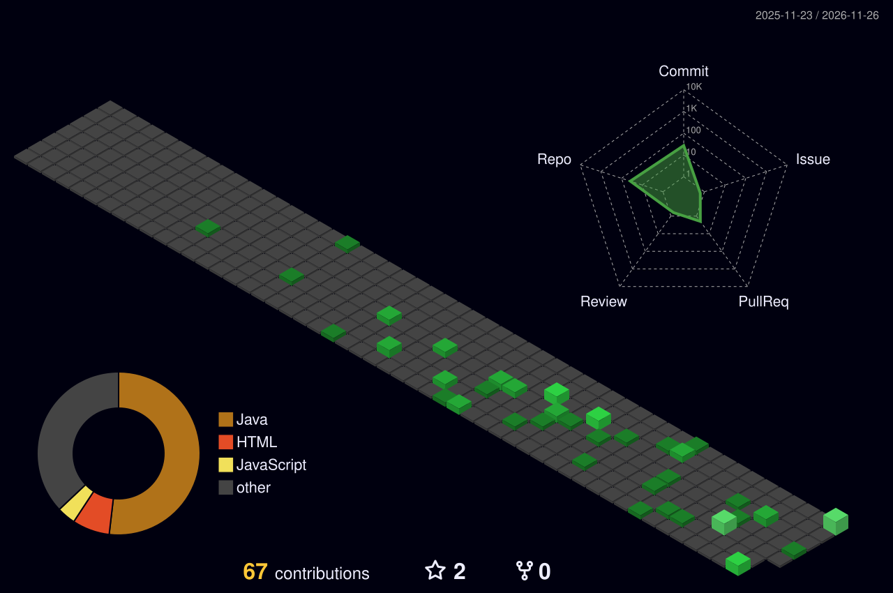

 

<table>
  <tr>
    <td width="50%" valign="top">

### Sobre mí

Soy **Sebastián**, junior developer de **Bucaramanga**. Me enfoco en el backend: diseñar APIs, modelar bases de datos y organizar el código en capas. Fuera de eso, me gusta crear videojuegos en Unity.

    </td>
    <td width="50%" valign="top">

### En qué ando

| | |
|:--|:--|
| **Construyendo** | APIs REST con Spring Boot |
| **Aprendiendo** | seguridad y pruebas en Spring |
| **Me interesa** | arquitectura en capas y bases de datos |
| **Fuera del código** | videojuegos 2D en Unity |

    </td>
  </tr>
</table>

---

<h2 align="center">Proyectos destacados</h2>

  
  
  
  
  
  

---

<h2 align="center">Actividad en GitHub</h2>

  
  

  

<picture>
  <source media="(prefers-color-scheme: dark)" srcset="./profile-3d-contrib/profile-night-green.svg" />
  <source media="(prefers-color-scheme: light)" srcset="./profile-3d-contrib/profile-green-animate.svg" />
  
</picture>

---

  
  

