
 

<table>
  <tr>
    <td width="50%" valign="top">

### Sobre el jugador

Soy **Sebastián**, junior developer de **Bucaramanga**. Me gusta construir el backend que hace funcionar las cosas y, cuando toca descansar, crear videojuegos en Unity.

    </td>
    <td width="50%" valign="top">

### Registro de misiones

| Misión | Estado |
|:--|:--:|
| APIs REST con Spring Boot | `EN CURSO` |
| Seguridad y pruebas en Spring | `ENTRENANDO` |
| Videojuegos 2D en Unity | `SIDE QUEST` |
| Bases de datos relacionales | `COMPLETADA` |

    </td>
  </tr>
</table>


---

<h2 align="center">SELECCIONA UN NIVEL</h2>

  <a href="https://github.com/SebasF10/coworkhub"></a>
  <a href="https://github.com/SebasF10/Neo-Space"></a>
  <a href="https://github.com/SebasF10/medisalud"></a>
  <a href="https://github.com/SebasF10/Proyecto_TutorBot_Grupo3"></a>
  <a href="https://github.com/SebasF10/RunShip"></a>
  <a href="https://github.com/SebasF10/Teachable_Machine_proyecto"></a>

---

<h2 align="center">HIGH SCORES</h2>

  
  

  

<h3 align="center">Pac-Man se come mis contribuciones</h3>

<picture>
  <source media="(prefers-color-scheme: dark)" srcset="https://raw.githubusercontent.com/SebasF10/SebasF10/output/pacman-contribution-graph-dark.svg" />
  <source media="(prefers-color-scheme: light)" srcset="https://raw.githubusercontent.com/SebasF10/SebasF10/output/pacman-contribution-graph.svg" />
  
</picture>

<h3 align="center">Y en Galaga las defiende</h3>

<picture>
  <source media="(prefers-color-scheme: dark)" srcset="https://raw.githubusercontent.com/SebasF10/SebasF10/output/galaga-contribution-graph-dark.svg" />
  <source media="(prefers-color-scheme: light)" srcset="https://raw.githubusercontent.com/SebasF10/SebasF10/output/galaga-contribution-graph.svg" />
  
</picture>

---

  
  

